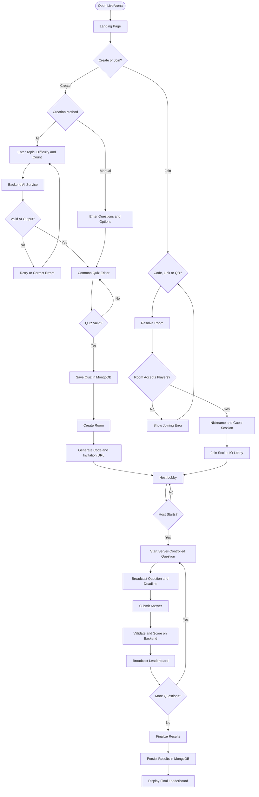
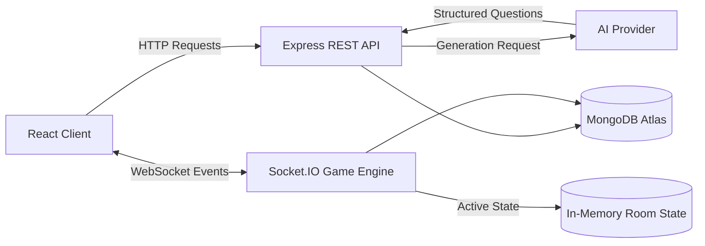

# LiveArena — Product Requirements Document (PRD)

**Version:** 1.0  
**Status:** Proposed — Pending Approval  
**Project Type:** Full-stack web application  
**Target Release:** One-week MVP for college continuous assessment  
**Primary Goal:** Demonstrate a polished, AI-powered, real-time multiplayer quiz platform using MongoDB.

--- 

## 1. Product Overview

### 1.1 Product Summary

LiveArena is a real-time multiplayer quiz platform where users can create quizzes manually or generate them using AI, invite participants through a room code, invitation link, or QR code, and host live quiz sessions with synchronized questions, server-controlled timers, automatic scoring, and real-time leaderboards.

The platform is designed to provide an interactive quiz experience similar to live classroom quiz systems, with an emphasis on simplicity, speed, and demonstrable full-stack engineering.

### 1.2 Problem Statement

Traditional quiz applications often focus on static questions and individual attempts. They may lack an integrated workflow for AI-assisted quiz creation, frictionless guest joining, and synchronized multiplayer competition.

LiveArena addresses these issues by combining:

- Manual quiz creation for complete control.
- AI-assisted quiz generation from a topic and optional description.
- Multiple ways to join a hosted game.
- Live multiplayer gameplay using WebSockets.
- Server-authoritative scoring and leaderboards.
- Persistent quiz and result storage in MongoDB.

### 1.3 Product Vision

Build a fast, engaging quiz experience in which a host can create or generate a quiz, launch a multiplayer session, invite participants, and conduct a live competition without requiring participants to create accounts.

### 1.4 Target Users

**Quiz host:** A student, teacher, presenter, or organizer who creates a quiz, manages the lobby, and starts the game.

**Participant:** Someone who joins a quiz using a room code, link, or QR code and competes using a nickname.

**Evaluator:** A teacher or assessor who wants to observe the complete application workflow, database persistence, AI integration, and real-time communication.

---

## 2. Product Goals and Success Criteria

### 2.1 Primary Goals

1. Enable hosts to create a valid quiz manually or with AI assistance.
2. Provide a common quiz editor for both creation methods.
3. Allow participants to join a quiz through three different entry methods.
4. Synchronize live questions, timers, and leaderboards across connected clients.
5. Calculate scores on the backend rather than trusting frontend submissions.
6. Persist quizzes and completed game results in MongoDB.
7. Deliver a stable MVP that can be demonstrated within one week.

### 2.2 MVP Success Criteria

The MVP is considered successful when:

- A host can create and save a quiz containing multiple-choice questions.
- AI can generate a configurable number of questions, defaulting to 10.
- AI-generated questions can be reviewed and edited before publication.
- Participants can join the correct game using a room code, invitation link, or QR code.
- The host can launch a game with multiple participants.
- Questions and timers stay synchronized between connected players.
- The server validates answers and calculates scores.
- The leaderboard updates during gameplay.
- Final results remain available after the game finishes and the page is refreshed.
- The demonstration can be completed without requiring user registration.

---

## 3. Scope Definition

### 3.1 Included in the MVP

- Responsive landing page.
- Manual quiz creation.
- AI-powered quiz generation.
- Shared quiz editor and validation.
- Saving and retrieving quizzes.
- Creating a live room.
- Unique room codes, invitation links, and QR codes.
- Guest joining with nicknames.
- Host lobby and participant list.
- Server-controlled question timers.
- Multiple-choice questions with one correct answer.
- Automatic scoring.
- Real-time leaderboard.
- Final results page.
- MongoDB persistence.
- Basic loading, validation, error, and reconnection handling.

### 3.2 Explicitly Out of Scope

To keep the one-week timeline realistic, the initial release will not include:

- User registration, login, or OAuth.
- Paid subscriptions or billing.
- Tournaments and scheduled leagues.
- Video, audio, or screen sharing.
- Subjective questions requiring manual grading.
- Multiple-correct-answer questions.
- Public quiz discovery or a social feed.
- Advanced anti-cheat or proctoring systems.
- Redis, distributed Socket.IO servers, or multi-server scaling.
- Persistent recovery of a live game after the backend process restarts.
- AI-generated questions during an active game.

These may be considered after the MVP is stable.

---

## 4. User Roles and Permissions

### 4.1 Host

The host can:

- Create a quiz manually or using AI.
- Edit and validate questions.
- Save and publish a quiz.
- Create a room for a saved quiz.
- Share the room code, invitation link, or QR code.
- View participants in the lobby.
- Start the quiz.
- Advance through questions according to the game rules.
- View the live leaderboard and final results.

For the MVP, the host is not a competing player in the same quiz.

### 4.2 Participant

A participant can:

- Join an available room.
- Enter a nickname.
- View the lobby until the host starts the quiz.
- Receive questions and timer updates.
- Submit one answer per question.
- View answer feedback according to game rules.
- View the leaderboard and final results.

A participant cannot:

- Start or control the host's game.
- Change questions or correct answers.
- Submit a score directly.
- Access hidden answer keys before the question closes.

### 4.3 Guest Identity

No account is required. The backend issues a participant/session identifier when the guest successfully joins a room. The client retains the identifier needed to reconnect during the current session.

Guest identities are temporary and should not be treated as verified real-world identities.

---

## 5. Core User Journeys

### 5.1 Landing Page

The landing page presents two primary actions:

**Create a Quiz**
- Create manually.
- Generate using AI.

**Join a Quiz**
- Enter a room code.
- Open an invitation link.
- Scan a QR code that opens the invitation URL.

A joining method ultimately resolves to the same backend room-validation process.

### 5.2 Manual Quiz Creation

1. Host selects **Create Manually**.
2. Host enters the quiz title and optional description.
3. Host adds questions.
4. Each question includes a prompt, answer options, correct answer, and optional explanation.
5. Host configures the default or selected number of questions and timing settings.
6. Frontend performs basic validation.
7. Backend validates the payload again.
8. Valid quiz is saved to MongoDB.
9. Host opens the quiz preview or launches a room.

### 5.3 AI Quiz Generation

1. Host selects **Generate with AI**.
2. Host enters a required topic.
3. Host optionally enters a description or learning context.
4. Host chooses a difficulty level.
5. Host specifies the number of questions, defaulting to 10.
6. Backend sends a structured generation request to the configured AI provider.
7. AI returns questions and answer options in the required schema.
8. Backend parses and validates the response.
9. Invalid or malformed questions are rejected or sent through a controlled retry.
10. Valid questions are displayed in the common quiz editor.
11. Host reviews, edits, adds, or removes questions.
12. Host saves the approved quiz to MongoDB.

AI output must never be published blindly. Human review is required before a quiz is used in a live session.

### 5.4 Creating and Sharing a Room

1. Host selects a saved quiz and chooses **Host Live Quiz**.
2. Backend verifies that the quiz exists and is usable.
3. Backend creates a unique room code and room/session record.
4. Backend returns the room code and invitation URL.
5. Frontend generates a QR code from the invitation URL.
6. Host enters the lobby and can share any of the three joining methods.

The room code must be sufficiently unique, and the backend must reject attempts to create conflicting active room codes.

### 5.5 Joining a Room

1. Participant enters a room code or opens the invitation URL or QR destination.
2. Frontend requests room validation.
3. Backend checks whether the room exists, is open, and is accepting players.
4. Participant enters a nickname.
5. Backend issues a guest participant/session identifier and joins the participant to the room.
6. Socket.IO confirms the join.
7. Host and participants receive lobby updates.

If the room is invalid, closed, full, or already in progress without late joining enabled, the frontend explains the problem and provides a way to return to the joining screen.

### 5.6 Playing the Quiz

1. Host starts the quiz.
2. Backend verifies host authority and room state.
3. Backend selects the first question and records its start and expiry times.
4. The question and timing information are broadcast through Socket.IO.
5. Participants submit their selected answers.
6. Backend verifies the participant, question, submission window, and duplicate-submission status.
7. Backend records accepted answers and calculates scores.
8. At the deadline or when the host advances, the question closes.
9. The backend broadcasts the allowed answer feedback and updated leaderboard.
10. The process repeats until the last question.

### 5.7 Completing the Quiz

1. Backend closes the final question.
2. Backend calculates final rankings and tie handling.
3. The session is marked completed.
4. Final session and player results are persisted in MongoDB.
5. Host and participants receive the final leaderboard.
6. Results can be retrieved after refreshing the page.

---

## 6. Application Flow Diagram



---

## 7. Functional Requirements

Priority definitions:

- **P0:** Essential for the assessment demo.
- **P1:** Important for reliability and presentation.
- **P2:** Deferred enhancement.

### FR-01: Landing Page — P0

The system shall present clear actions for creating a quiz and joining a quiz.

Acceptance criteria:
- A user can navigate to either flow.
- The joining form accepts a room code.
- Invitation URLs resolve to the appropriate room.
- QR codes encode the invitation URL.

### FR-02: Manual Quiz Creation — P0

The system shall allow hosts to define a quiz title, optional description, questions, options, correct answers, difficulty, and timing settings.

Acceptance criteria:
- Each question has a prompt and valid answer options.
- Each single-correct-answer question has exactly one correct option.
- Empty or invalid questions cannot be published.
- Saved quizzes can be retrieved.

### FR-03: AI Quiz Generation — P0

The system shall generate structured multiple-choice questions from a topic, optional context, difficulty, and question count.

Default settings:
- Question count: 10.
- Difficulty: Medium.
- Question type: Single-correct-answer multiple choice.

Acceptance criteria:
- The backend uses an environment-configured AI provider.
- API keys never reach the browser.
- The generated response is schema-validated.
- The host can edit AI-generated content before saving.
- AI failures display a useful error and allow retry or manual creation.

### FR-04: Common Quiz Editor — P0

Both manual and AI-assisted quiz creation shall use the same editor.

Acceptance criteria:
- The host can add, edit, and delete questions.
- The host can edit options and correct answers.
- The editor validates all questions before saving.
- The host can preview the final quiz.

### FR-05: Quiz Persistence — P0

The backend shall persist quizzes in MongoDB.

Acceptance criteria:
- Saved quizzes remain available after a backend restart.
- Quiz retrieval is performed through the backend.
- The frontend does not directly access the database.

### FR-06: Room Creation — P0

The backend shall create a unique active room associated with a saved quiz.

Acceptance criteria:
- A valid quiz is required.
- The backend issues a unique room code.
- The host receives a code, invitation URL, and room details.
- Closed or completed rooms cannot accept ordinary new joins.

### FR-07: Room Joining — P0

The application shall support joining through a code, invitation URL, and QR code.

Acceptance criteria:
- All three mechanisms resolve to the same room.
- Invalid, closed, and unavailable rooms are rejected.
- Nicknames are validated.
- Duplicate or conflicting participant submissions are handled safely.

### FR-08: Lobby Management — P0

The system shall show the host and connected participants a synchronized lobby.

Acceptance criteria:
- Participant joins and departures update the lobby.
- Only the authorized host can start the quiz.
- A game cannot start without a valid quiz and session.

### FR-09: Real-Time Gameplay — P0

The backend shall control the quiz state and broadcast active questions.

Acceptance criteria:
- Questions appear consistently for connected players.
- The backend determines the submission deadline.
- Answers submitted after the deadline are rejected.
- The client cannot select the next question by altering local state.

### FR-10: Answer Validation and Scoring — P0

The backend shall validate each submission and calculate scores.

Acceptance criteria:
- A participant cannot score by submitting a claimed score.
- The answer must belong to the active question.
- Only accepted submissions are scored.
- Duplicate submissions follow the defined rule.
- The final result is calculated from accepted submissions.

### FR-11: Live Leaderboard — P0

The system shall broadcast an updated leaderboard after each question is scored.

Acceptance criteria:
- Participants see rankings and scores update during gameplay.
- The backend is the source of truth for scores.
- Tie-breaking behaviour is deterministic.

### FR-12: Result Persistence — P0

The backend shall save final results to MongoDB.

Acceptance criteria:
- A completed session contains its quiz reference, timing/status information, and final participant results.
- Results can be fetched after page refresh.
- Results are not duplicated by repeated completion requests.

### FR-13: Error and Connection Handling — P1

The system should explain recoverable failures and handle temporary disconnections.

Acceptance criteria:
- Invalid room codes produce a clear message.
- AI provider failures do not corrupt a quiz.
- Reconnecting participants can restore their session when the room is still active.
- A temporary network failure does not permit duplicate scoring.

---

## 8. Non-Functional Requirements

### Performance

- Normal REST requests should complete promptly under the small demo workload.
- Real-time question and leaderboard updates should be delivered with low latency on a local or stable network.
- AI generation may take longer and must display a loading state.
- Database operations must not block the frontend with unnecessary full-document retrievals.

Exact latency targets should be measured during testing rather than assumed.

### Reliability

- Backend validation is required even when frontend validation exists.
- A failed AI request must not save malformed questions.
- A room must have one authoritative game state.
- Completed results must be persisted before the system reports final completion as successful.

### Security

- Store database and AI credentials in server-side environment variables.
- Never expose API keys, connection strings, correct answer keys, or internal server state to clients before appropriate disclosure.
- Validate user inputs and enforce request-size limits.
- Rate-limit room creation, joining, and AI generation where practical.
- Protect host-only actions with a server-issued host session token.
- Treat room codes as identifiers, not as the sole authorization mechanism for host controls.
- Render participant input as text to mitigate injection and cross-site scripting risks.

### Scalability

The first release targets one Node.js application instance. Active rooms can be stored in server memory. This is acceptable for a single-server classroom demonstration but does not support reliable live-session recovery after a server restart or seamless multi-server scaling.

Redis and a Socket.IO adapter are deferred until multi-instance deployment is needed.

### Accessibility and Responsiveness

- Layout must work on desktop and mobile browsers.
- Main actions must be keyboard accessible.
- Inputs must have labels.
- Errors and validation feedback must be understandable.
- Colour must not be the only indicator of correctness or status.

---

## 9. Proposed Technical Architecture

### 9.1 Stack

| Layer | Proposed Technology | Responsibility |
|---|---|---|
| Frontend | React + TypeScript | User interface and client-side state |
| Styling | Tailwind CSS | Responsive visual design |
| Backend | Node.js + Express | REST API and business logic |
| Real-time | Socket.IO | Lobby, question, timer and leaderboard events |
| Database | MongoDB Atlas | Persistent quizzes and game results |
| ODM | Mongoose | Schema validation and MongoDB interaction |
| AI integration | Configurable LLM API | Generate structured quiz questions |
| QR generation | QR-code library | Encode invitation URLs |
| Validation | Zod or equivalent | Validate API and AI payloads |

This is the proposed stack, not an instruction to use every library immediately. The implementation should avoid unnecessary dependencies.

### 9.2 High-Level Architecture



### 9.3 Backend Modules

- **Quiz Module:** Create, retrieve, validate, and update quizzes.
- **AI Module:** Build generation prompts, call the provider, parse responses, and handle failures.
- **Room Module:** Create rooms, validate room status, and manage joining.
- **Game Module:** Control game states, active question, deadlines, and transitions.
- **Scoring Module:** Validate answers and calculate scores.
- **Results Module:** Finalize, persist, and retrieve results.
- **Socket Module:** Authenticate relevant events and broadcast room updates.

The modules can live inside a single Node.js application for the MVP.

---

## 10. MongoDB Data Architecture

MongoDB is the persistence layer, not the real-time transport system. React must never connect directly to MongoDB.

### 10.1 Collection: `quizzes`

Stores reusable quiz definitions.

Proposed document:

```json
{
  "_id": "ObjectId",
  "title": "JavaScript Fundamentals",
  "description": "A quiz about core JavaScript concepts",
  "source": "ai",
  "difficulty": "medium",
  "questions": [
    {
      "questionId": "q1",
      "text": "Which keyword declares a block-scoped variable?",
      "options": [
        { "optionId": "a", "text": "var" },
        { "optionId": "b", "text": "let" },
        { "optionId": "c", "text": "define" },
        { "optionId": "d", "text": "static" }
      ],
      "correctOptionId": "b",
      "explanation": "let declares a block-scoped variable.",
      "timeLimitSeconds": 20
    }
  ],
  "createdAt": "Date",
  "updatedAt": "Date"
}
```

Design rules:
- `source` records whether the quiz originated from manual creation or AI assistance.
- Correct answers are available to the authorized backend but must not be included in a participant's question payload before the question closes.
- The stored quiz must pass backend validation before it can be hosted.

### 10.2 Collection: `gameSessions`

Stores the lifecycle and final results of each hosted game.

Proposed document:

```json
{
  "_id": "ObjectId",
  "quizId": "ObjectId",
  "roomCode": "AB12CD",
  "status": "completed",
  "hostSessionId": "server-issued-session-id",
  "startedAt": "Date",
  "completedAt": "Date",
  "participants": [
    {
      "participantId": "server-issued-participant-id",
      "nickname": "PlayerOne",
      "score": 850,
      "correctAnswers": 8,
      "totalAnswered": 10,
      "rank": 1,
      "answers": [
        {
          "questionId": "q1",
          "selectedOptionId": "b",
          "isCorrect": true,
          "responseTimeMs": 4200,
          "pointsAwarded": 100
        }
      ]
    }
  ],
  "createdAt": "Date",
  "updatedAt": "Date"
}
```

The example is illustrative. A session can be created before the game starts and updated as the session progresses. For a one-week MVP, answer details may be embedded in the session document. If session documents become large, answer records can later be separated into another collection.

### 10.3 Active Room State

For the MVP, active game state remains in the Node.js process's memory.

It includes:
- Active room and quiz references.
- Connected participants.
- Current question index.
- Question start and expiry timestamps.
- Accepted answer submissions.
- Current game state.

This state is temporary. MongoDB stores durable quiz definitions and session/results data, while Socket.IO distributes real-time changes.

### 10.4 Recommended Indexes

- Unique index on normalized `roomCode` in `gameSessions`, according to the chosen room-retention policy.
- Index on `quizId`.
- Index on `createdAt` for recent quizzes or sessions, where useful.
- Indexes should be added based on actual query patterns.

If room codes must be reusable after expiration, use a separate active-room registry or an explicit lifecycle policy instead of assuming a permanent unique code can be reused.

### 10.5 Database Rules

1. Use Mongoose schemas and backend validation.
2. Use `ObjectId` references between quizzes and sessions.
3. Keep secrets and private answer keys off participant-facing API responses.
4. Store timestamps in a consistent UTC representation.
5. Do not save every countdown tick to MongoDB.
6. Persist meaningful lifecycle transitions and completed results.
7. Use environment variables for the connection string.

---

## 11. REST API Contract

All endpoints are served by the Express backend. Exact names can be refined during implementation, but frontend and backend should agree on the contract before development.

| Method | Endpoint | Purpose |
|---|---|---|
| `GET` | `/api/health` | Check backend availability |
| `POST` | `/api/quizzes` | Create and save a validated quiz |
| `GET` | `/api/quizzes/:quizId` | Retrieve a quiz for its owner/host flow |
| `PUT` | `/api/quizzes/:quizId` | Update a quiz before hosting |
| `POST` | `/api/ai/generate-quiz` | Generate draft quiz questions |
| `POST` | `/api/rooms` | Create a room for a saved quiz |
| `GET` | `/api/rooms/:roomCode` | Validate and retrieve public room details |
| `POST` | `/api/rooms/:roomCode/join` | Validate guest nickname and issue participant session |
| `GET` | `/api/sessions/:sessionId/results` | Retrieve completed results |

### API Rules

- Every request body must be validated.
- Responses should follow a consistent structure, for example `{ "data": ..., "error": null }`.
- Errors should include a stable error code and a user-safe message.
- Host-only operations require host authorization.
- Participant endpoints must not expose correct answers or other participants' private submission details.
- AI generation requests should have reasonable limits and timeouts.

---

## 12. Socket.IO Event Contract

Socket.IO is used for synchronized game activity, not as a replacement for durable database storage.

### Client-to-Server Events

| Event | Purpose |
|---|---|
| `room:join` | Join a valid room using the issued session |
| `room:leave` | Leave the current lobby or room |
| `game:start` | Ask the server to start the game |
| `answer:submit` | Submit a selected option for the active question |
| `game:next-question` | Host requests the next question, if manual advancement is enabled |
| `session:resume` | Restore an authorized participant session after reconnection |

### Server-to-Client Events

| Event | Purpose |
|---|---|
| `room:joined` | Confirm a successful room join |
| `room:state` | Send the current public lobby state |
| `room:player-joined` | Notify clients that a participant joined |
| `room:player-left` | Notify clients that a participant left |
| `game:started` | Announce game start |
| `question:started` | Deliver a question and its deadline |
| `answer:accepted` | Confirm an answer was accepted |
| `answer:rejected` | Explain a rejected submission |
| `question:ended` | Announce that the question has closed and provide permitted feedback |
| `leaderboard:updated` | Broadcast current rankings and scores |
| `game:completed` | Announce the final leaderboard and result reference |
| `error` | Report a structured real-time error |

### Real-Time Rules

- The server determines the current question, deadline, and score.
- Clients receive a deadline timestamp and calculate the visible countdown locally.
- The backend enforces the deadline independently of the displayed countdown.
- A participant's answer is accepted at most once per question in the MVP.
- Socket.IO rooms should be scoped to a specific game session.
- Host-only actions must verify the host session, not merely the claimed nickname or room code.
- Event payloads must be validated; clients must not be trusted to report scores or correctness.

---

## 13. Game Rules and Scoring

### 13.1 Question Format

The MVP supports four-option, single-correct-answer multiple-choice questions.

### 13.2 Timer

Every question has a configured time limit. The backend determines the start time and deadline. The default can be 20 seconds per question, adjustable by the host before launch.

### 13.3 Answer Submission

- One accepted submission per participant per question.
- Submissions must arrive before the server-side deadline.
- Invalid option identifiers are rejected.
- Late submissions receive a rejection.
- Duplicate submissions do not produce additional points.

### 13.4 Scoring

Recommended initial rule:

- Correct answer: 100 base points.
- Incorrect answer: 0 points.
- Unanswered question: 0 points.
- Optional speed bonus: deferred until basic scoring is stable.

If a speed bonus is added, the server calculates it using authoritative timestamps. Do not allow browser clocks or client-calculated point values to affect the score.

### 13.5 Leaderboard and Tie Handling

The leaderboard sorts by:
1. Total score, descending.
2. Number of correct answers, descending.
3. Total response time for correct answers, ascending, if timestamps are available and validated.
4. Equal remaining results share the same rank.

The rule should remain consistent from the live leaderboard to the final results.

---

## 14. Key UI Screens

### 14.1 Landing Page

- Product branding and short explanation.
- Create Quiz action.
- Join Quiz form.
- Optional recent or saved quiz area for the host.
- Responsive design.

### 14.2 Manual Quiz Builder

- Quiz metadata.
- Question editor.
- Answer-option editor.
- Correct-answer selection.
- Timing and difficulty settings.
- Validation and save actions.

### 14.3 AI Generation Form

- Topic input.
- Optional description.
- Difficulty selector.
- Question-count field with 10 as the default.
- Generate button and progress state.
- Error and retry feedback.

### 14.4 Quiz Review and Editor

- Editable generated/manual questions.
- Add, delete, and reorder controls.
- Correct-answer indicators.
- Preview and save actions.

### 14.5 Host Lobby

- Room code prominently displayed.
- Invitation link and QR code.
- Connected participant count and list.
- Start button enabled only when the room is ready.
- Connection and room status.

### 14.6 Participant Lobby

- Nickname and room information.
- Participant count.
- Waiting status.
- Clear transition when the host starts.

### 14.7 Gameplay Screen

- Question and answer choices.
- Countdown based on the server deadline.
- Submission status.
- Answer feedback when permitted.
- Current score and leaderboard.

### 14.8 Results Screen

- Final rankings.
- Scores and correct-answer counts.
- Quiz summary.
- Session result identifier.
- Option to return to the landing page.

---

## 15. Error Handling and Edge Cases

| Scenario | Expected Behaviour |
|---|---|
| Invalid room code | Display an invalid-room message |
| Room is full or closed | Reject joining and explain why |
| AI request times out | Preserve the form and offer retry/manual creation |
| AI returns invalid JSON | Parse and validate; reject malformed output |
| Quiz contains missing answers | Block saving or hosting |
| Two hosts attempt to start simultaneously | Only one valid state transition succeeds |
| Player submits after the deadline | Reject the submission |
| Player submits twice | Accept at most one submission |
| Player disconnects temporarily | Allow session resume while the room remains active |
| Host disconnects | Pause or maintain the game according to a simple, documented policy |
| Backend restarts | Active games may be lost in the MVP; saved quizzes and persisted results remain |
| Database is unavailable | Return a service error and avoid falsely reporting a successful save |
| Duplicate room-code generation | Generate a new code and retry safely |
| Completed game is finalized twice | Use an idempotent completion transition to avoid duplicate results |

The host-disconnection policy should be selected before implementation. For the first release, a short reconnect grace period followed by pausing the game is preferable to silently continuing an unmanageable session.

---

## 16. Security and Abuse Prevention

The application is a demo product, but it must still establish sensible server-side trust boundaries.

- Store `MONGODB_URI` and the AI API key only on the backend.
- Add server-side validation to every write endpoint and Socket.IO event.
- Limit AI question counts and prompt length.
- Apply basic request rate limits to room creation and AI generation.
- Use unguessable server-issued session tokens for host and participant permissions.
- Do not give the host's secret token to other participants.
- Do not broadcast correct answers before the question closes.
- Never accept score or correctness values from the client.
- Avoid logging raw secrets or full sensitive provider responses.
- Set reasonable maximum nickname and question lengths.
- Escape or safely render user-generated text.
- Use HTTPS and secure connection settings when deployed publicly.

Guest access removes the need for account registration, but it does not eliminate the need for authorization.

---

## 17. Observability and Demonstration Evidence

The MVP should include enough diagnostics to show that the system is working.

Recommended evidence:
- Backend health endpoint.
- Clear server logs for room creation, game start, answer acceptance/rejection, and game completion.
- MongoDB records for saved quizzes and completed sessions.
- Browser demonstration of three joining methods.
- Two or more participant windows showing synchronized question updates.
- Leaderboard changes after answers are scored.
- A page refresh showing that quiz definitions and final results persisted.

Logs must not contain database passwords, AI keys, or reusable session secrets.

---

## 18. Seven-Day Development Plan

The plan prioritizes a working end-to-end game before optional visual polish.

### Day 1 — Project Foundation and Database

- Set up frontend and backend projects.
- Configure MongoDB Atlas.
- Connect Mongoose.
- Add environment-variable handling and a health endpoint.
- Define the quiz and game-session schemas.

**Deliverable:** Backend starts successfully and can save and retrieve a test quiz.

### Day 2 — Manual Quiz Creation

- Build the landing page.
- Implement the manual quiz form and editor.
- Add client and server validation.
- Implement quiz creation and retrieval APIs.

**Deliverable:** A manually created quiz is persisted in MongoDB.

### Day 3 — AI Quiz Generation

- Add the AI generation form.
- Implement provider integration on the backend.
- Validate structured output.
- Connect generated questions to the shared editor.
- Add failure and retry handling.

**Deliverable:** A host can generate, edit, and save a quiz.

### Day 4 — Room Creation and Joining

- Create unique room codes.
- Build the host lobby and participant lobby.
- Implement code and invitation-link joining.
- Add QR generation.
- Establish Socket.IO connection and guest sessions.

**Deliverable:** A host and multiple guests can enter the same lobby.

### Day 5 — Multiplayer Gameplay

- Implement game states.
- Broadcast questions and deadlines.
- Validate answer submissions.
- Add timer enforcement and score calculation.
- Handle duplicate and late submissions.

**Deliverable:** A complete multiplayer quiz works across multiple browser windows.

### Day 6 — Leaderboard and Results

- Implement live leaderboard broadcasts.
- Finalize ranking and tie rules.
- Persist session status and final results.
- Build the final results screen.
- Test refresh and reconnect scenarios.

**Deliverable:** Players can complete a game and see persisted results.

### Day 7 — Testing, Fixes, and Assessment Demo

- Test invalid codes and malformed quizzes.
- Test AI failures and question validation.
- Test the game with multiple clients.
- Verify MongoDB records and server-side scoring.
- Improve loading states, error messages, and responsive layouts.
- Prepare a short demonstration script.

**Deliverable:** A stable MVP with evidence of AI integration, real-time communication, backend validation, and MongoDB persistence.

---

## 19. Acceptance Test Checklist

### Quiz Creation
- [ ] Create a manual quiz with multiple valid questions.
- [ ] Reject invalid quiz data.
- [ ] Generate a 10-question quiz with AI.
- [ ] Edit AI-generated questions before saving.
- [ ] Refresh and confirm the quiz remains available.

### Joining
- [ ] Join using a room code.
- [ ] Join using an invitation URL.
- [ ] Join using a QR code.
- [ ] Reject an invalid or closed room.
- [ ] Prevent unauthorized host actions.

### Multiplayer
- [ ] Start a quiz with multiple participants.
- [ ] Deliver synchronized questions.
- [ ] Enforce the server-side timer.
- [ ] Reject duplicate and late answers.
- [ ] Update the leaderboard after scoring.
- [ ] Complete a quiz and show final rankings.

### Persistence and Reliability
- [ ] Verify quizzes in MongoDB.
- [ ] Verify completed sessions and player results in MongoDB.
- [ ] Refresh the results screen and retrieve stored data.
- [ ] Simulate AI failure.
- [ ] Simulate a temporary player disconnection.
- [ ] Verify that the client cannot manipulate scores.

---

## 20. Demo Presentation Flow

A concise assessment demonstration should follow this order:

1. Open the landing page and explain the two main actions.
2. Generate a quiz from a topic using the AI form.
3. Edit a generated question to show that AI output is reviewable.
4. Save the quiz and show its persistence in MongoDB.
5. Create a live room and display the invitation link and QR code.
6. Join from two separate browser windows using different joining methods.
7. Start the game and demonstrate synchronized questions and timers.
8. Submit answers from the player windows and show the live leaderboard.
9. Finish the quiz and display the final rankings.
10. Refresh the results page and show that completed results remain available in MongoDB.

This sequence demonstrates the entire product rather than just its UI.

---

## 21. Risks and Mitigation

**AI response quality:** Models can generate incorrect or malformed questions. Validate schema, require host review, and allow editing.

**AI provider availability:** External API limits or failures may affect generation. Keep manual quiz creation fully functional and provide a retry path.

**Real-time state complexity:** Game timing, answer acceptance, and duplicate submissions are easy to implement incorrectly. Keep the backend authoritative and use explicit game states.

**One-week delivery risk:** Trying to add accounts, tournaments, advanced animations, and multiple question types could derail the MVP. Deliver the complete core path first.

**Server restart risk:** In-memory active rooms are lost when the server restarts. Make this limitation explicit and persist completed results. Live-game recovery can be a future enhancement.

**Security risk:** Guest sessions are convenient but weaker than authenticated accounts. Use server-issued session tokens and separate host permissions from participant permissions.

---

## 22. Future Enhancements

After the core MVP is stable, potential enhancements include:

- Persistent accounts and quiz libraries.
- Public quiz sharing and discoverability.
- Multiple question formats.
- Image-based questions.
- Advanced speed-based scoring.
- AI question regeneration and quality checks.
- Analytics for question difficulty and player performance.
- Redis-backed room state and horizontal scaling.
- Recovery of ongoing games after server restarts.
- Exportable reports and classroom management.

These enhancements should not be added until the acceptance tests for the initial release pass.

---

## 23. Final Product Definition

LiveArena is a browser-based, AI-assisted multiplayer quiz platform built around three core capabilities:

1. **Create:** Build questions manually or generate a draft with AI, review it, and save it.
2. **Compete:** Create a live room, invite guests using a code, link, or QR, and play with synchronized questions and server-side scoring.
3. **Review:** See a live leaderboard and persist the completed game results in MongoDB.

The initial implementation uses React, Node.js, Express, Socket.IO, MongoDB Atlas, and Mongoose. It runs as a single backend instance with temporary in-memory live-game state and durable quiz and result storage.

**The project's central engineering principle is that the backend owns game state and scoring, Socket.IO distributes live updates, and MongoDB preserves durable data.**

The PRD is ready for review. Before implementation, the next technical document should define the exact Mongoose schemas, REST request/response payloads, Socket.IO event payloads, and permitted game-state transitions so the frontend and backend can be developed against a single contract.
